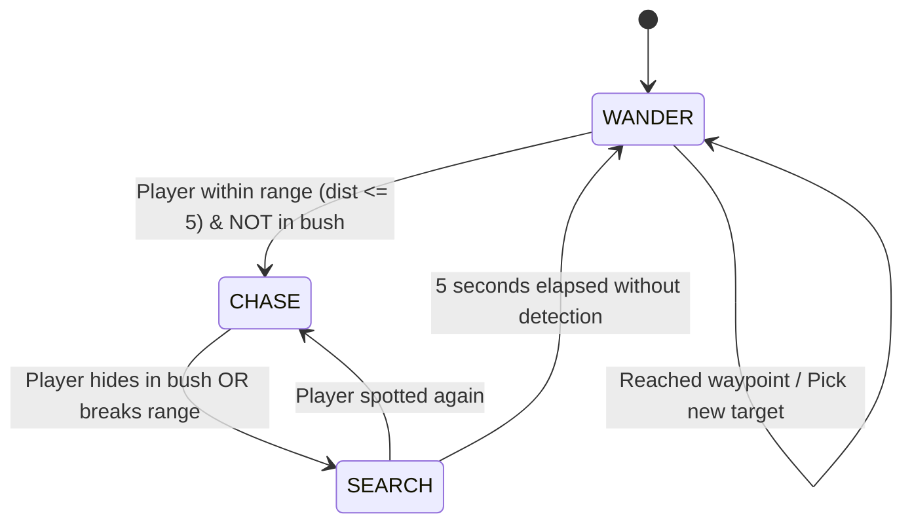

# Dungeon Crawler: A* Pathfinding & Dynamic AI Stealth Game

[](https://www.python.org/)
[](https://www.pygame.org/)
[](https://en.wikipedia.org/wiki/A*_search_algorithm)
[](https://www.microsoft.com/)
[](LICENSE)

An intelligent 2D top-down dungeon crawler and stealth survival game developed with **Python** and **Pygame**. The game implements real-time **Weighted A\* (A-Star) Pathfinding**, dynamic **Procedural Maze Generation (Recursive Backtracking)**, a multi-tier **Finite State Machine (FSM)** for autonomous enemy agents, and an atmospheric **Fog-of-War** dynamic lighting engine.

---

## Table of Contents

- [Overview](#overview)
- [Key Features](#key-features)
- [Artificial Intelligence & Algorithms](#artificial-intelligence--algorithms)
  - [1. Weighted A* Pathfinding Algorithm](#1-weighted-a-pathfinding-algorithm)
  - [2. Enemy Finite State Machine (FSM)](#2-enemy-finite-state-machine-fsm)
  - [3. Procedural Maze Generation & Braiding](#3-procedural-maze-generation--braiding)
  - [4. Stealth & Vision System](#4-stealth--vision-system)
- [Controls & Keybindings](#controls--keybindings)
- [Visual Presentation & HUD](#visual-presentation--hud)
- [Project Architecture & File Structure](#project-architecture--file-structure)
- [Installation & Setup](#installation--setup)
  - [Prerequisites](#prerequisites)
  - [Running from Source](#running-from-source)
  - [Running the Standalone Executable](#running-the-standalone-executable)
  - [Building with PyInstaller](#building-with-pyinstaller)
- [Settings & Save System](#settings--save-system)
- [License](#license)

---

## Overview

In **Dungeon Crawler**, the player spawns at the bottom-right corner `(31, 31)` of a labyrinthine, procedurally generated dungeon on a 33x33 grid. The objective is to safely reach the golden exit portal located at `(1, 1)` while evading patrolling skeletal enemies.

As the player navigates through the dungeon:
- Patrolling enemies dynamically calculate search routes and vision cones.
- If spotted, enemies switch to aggressive pursuit mode, utilizing the shortest path via **A\*** pathfinding.
- The player can utilize **stealth foliage (bushes)** to break line-of-sight and deceive the enemy AI.
- An optimal visual path indicator (rendered in blue) dynamically assists the player by finding the quickest route to the exit portal.
- Clearing a level unlocks the next stage with increased enemy density, ramping up the difficulty.

---

## Key Features

- **Dynamic Weighted A\* Search**: Used for both player navigation hints and intelligent enemy pursuit/patrol logic with variable terrain weights.
- **Hierarchical FSM Enemy AI**: Seamless transitions between `WANDER`, `CHASE`, and `SEARCH` states based on line-of-sight and proximity detection.
- **Stealth Mechanics & Foliage Concealment**: Bushes impose a higher movement cost ($cost = 5$) but completely conceal the player from enemy detection cones.
- **Dynamic Fog of War**: Soft gradient radial lighting around the player casts realistic darkness over unexplored dungeon corridors.
- **Procedural Maze Generation with Braiding**: Depth-First Search (DFS) recursive backtracking coupled with randomized loop generation to eliminate dead ends.
- **Multi-Slot Persistence**: Full save/load system supporting 5 custom-named slots serialized to JSON format.
- **Multi-Channel Sound Engine**: Dedicated mixer channels for footstep audio (walk vs. sprint vs. bush rustle), enemy bones rattling, spotted alerts, and background music.
- **Adjustable Settings**: Live configuration for framerate (30 / 60 / 144 FPS) and shadow toggle.
- **Standalone Windows Executable**: Bundled with all sprites and audio assets using PyInstaller.

---

## Artificial Intelligence & Algorithms

### 1. Weighted A* Pathfinding Algorithm

The core pathfinding module employs the **A\* (A-Star)** heuristic search algorithm to compute the shortest obstacle-free path between arbitrary grid coordinates:

$$f(n) = g(n) + h(n)$$

Where:
- **$g(n)$**: The exact cost of the path from the starting tile to the current tile $n$.
- **$h(n)$**: The estimated heuristic cost from $n$ to the goal. This implementation utilizes the **Manhattan Distance** heuristic, ideal for 4-directional grid movement:
  
  $$h(n) = |x_n - x_{goal}| + |y_n - y_{goal}|$$

- **$f(n)$**: Total estimated path cost through node $n$.

#### Terrain Cost Matrix:
| Terrain Type | Grid Value | Traversal Cost | Effect on Pathfinding |
| :--- | :---: | :---: | :--- |
| **Open Stone/Wood Floor** | `0` | $1$ | Default movement cost |
| **Impassable Wall** | `1` | $\infty$ | Solid obstacle (pruned from search tree) |
| **Foliage / Bush** | `2` | $5$ | High cost (enemies prefer avoiding unless necessary) |

#### Optimization:
- Utilizes Python's native `heapq` (Min-Heap Priority Queue) for optimal $O(\log N)$ extraction of open-set nodes with lowest $f$-score.
- Hash-map lookups for $g$-score tracking ensure rapid coordinate updates and loop prevention.

---

### 2. Enemy Finite State Machine (FSM)

Each enemy non-player character (NPC) acts as an autonomous agent governed by a Finite State Machine:



- **`WANDER`**: The enemy selects random traversable coordinates across the map and follows an A* computed trajectory. Enemies utilize inter-agent collision detection to prevent overlapping on identical tiles.
- **`CHASE`**: Triggered when the player is within a Manhattan distance of 5 tiles and not concealed inside a bush. Triggers an alert audio cue and continuously computes the A* path to the player's active position.
- **`SEARCH`**: When the player enters foliage or escapes the detection threshold, the enemy transitions to a 5-second investigation phase before returning to ambient patrol.

---

### 3. Procedural Maze Generation & Braiding

The dungeon grid is generated at runtime using a modified **Recursive Backtracking (DFS)** algorithm:
1. Initialize the entire 33x33 grid with solid walls (`1`).
2. Starting at `(1, 1)`, randomly step two cells in cardinal directions (`(0, 2)`, `(0, -2)`, `(2, 0)`, `(-2, 0)`).
3. Carve passageways by setting intervening and destination cells to floor (`0`).
4. **Braiding Phase**: Pure mazes contain many dead-ends. The engine performs an automated braiding pass by breaking 80 random internal walls to introduce multiple loops and flanking routes.
5. **Foliage Placement**: 50 random floor tiles are designated as stealth foliage bushes (`2`).

---

### 4. Stealth & Vision System

- **Vision Cones**: Enemies project an active $60^\circ$ field-of-view cone matching their current heading vector ($\theta = \text{atan2}(-\Delta y, \Delta x)$).
- **Stealth Camouflage**: Stepping into bush tiles (`grid == 2`) activates camouflage mode, immediately breaking enemy line-of-sight and triggering their `SEARCH` state.
- **Stamina & Noise Simulation**:
  - **Walking** (default): Quiet footsteps, movement delay = 155ms.
  - **Sprinting** (`Left Shift`): Movement delay drops to 85ms, consuming stamina (-7 per step) and playing loud running footsteps.
  - **Exhaustion**: If stamina falls below 7, sprint is disabled until stamina regenerates.

---

## Controls & Keybindings

| Key / Action | Context | Action Description |
| :--- | :--- | :--- |
| <kbd>↑</kbd> <kbd>↓</kbd> <kbd>←</kbd> <kbd>→</kbd> | Gameplay | Move Player (Up, Down, Left, Right) |
| <kbd>Left Shift</kbd> | Gameplay | Hold to Sprint (drains Stamina bar) |
| <kbd>Esc</kbd> | Gameplay | Pause game / Open Pause Menu |
| <kbd>Esc</kbd> | Menus | Return to previous menu / Exit |
| <kbd>F11</kbd> | Anywhere | Toggle Fullscreen Mode |
| <kbd>Enter</kbd> / <kbd>Return</kbd> | Menus | Confirm selection / Submit save name |
| <kbd>Delete</kbd> / <kbd>Backspace</kbd> | Save Menu | Delete highlighted save slot |
| <kbd>Mouse Left-Click</kbd> | Menus | Select menu buttons and UI options |

---

## Visual Presentation & HUD

- **Player**: Represented with yellow sprite / custom avatar.
- **Enemies**: Red skeleton avatars with directional vision indicators.
- **Exit Portal**: Glowing yellow tile at coordinate `(1, 1)`.
- **A\* Path Guide**: Real-time blue route line tracing the optimal trajectory to the exit.
- **Alert Indicator**: Flashing red `! SPOTTED !` warning banner when an enemy enters `CHASE` mode.
- **HUD Panel**: Displays active Dungeon Level, dynamic Stamina bar gauge, and audio state.

---

## Project Architecture & File Structure

```text
├── Project-1.py               # Main Python source code (Game Loop, A*, FSM, Fog, Pygame UI)
├── build.py                   # PyInstaller automated packaging script
├── Dungen_Crawler.spec        # PyInstaller specification file
├── requirements.txt           # Python dependency specifications
├── .gitignore                 # Standard Python/IDE ignore rules
│
├── Dungeon Crawler v2.exe     # Standalone portable Windows executable
│
├── Assets (Sprites & Textures)
│   ├── player.png             # Player character sprite
│   ├── enemy.png              # Enemy skeleton sprite
│   ├── wall.png               # Stone dungeon wall texture
│   ├── bush.png               # Concealment foliage texture
│   ├── game_icon.png          # High-resolution game logo
│   └── game_icon.ico          # Windows executable application icon
│
├── Audio Assets
│   ├── background_music.mp3   # Ambient dungeon soundtrack
│   ├── walk.wav               # Quiet walking sound effect
│   ├── run.wav                # Sprinting sound effect
│   ├── hide.wav               # Bush rustling / concealment sound effect
│   ├── alert.wav              # Spotted alert sound effect
│   ├── skeleton.wav           # Ambient skeleton rattle sound effect
│   ├── win.wav                # Level victory fanfare
│   └── lose.wav               # Game over audio cue
│
└── Documentation & Reports
    └── Report/
        ├── AI Report 1.docx   # Academic Project Report & Documentation
        └── AI Report 2.docx   # Extended Algorithm & Research Paper
```

---

## Installation & Setup

### Prerequisites

- **Python 3.8+** installed on your system ([Download Python](https://www.python.org/downloads/)).
- **Pip** package manager.

### Running from Source

1. **Clone the repository:**
   ```bash
   git clone https://github.com/Dhanushrdy/2D-Stealth-Dungeon-Crawler.git
   cd 2D-Stealth-Dungeon-Crawler
   ```

2. **Create and activate a virtual environment (recommended):**
   ```bash
   # On Windows
   python -m venv .venv
   .venv\Scripts\activate

   # On macOS / Linux
   python3 -m venv .venv
   source .venv/bin/activate
   ```

3. **Install dependencies:**
   ```bash
   pip install -r requirements.txt
   ```

4. **Launch the game:**
   ```bash
   python Project-1.py
   ```

---

### Running the Standalone Executable

If you are running Windows and prefer not to install Python:
1. Navigate to the project root directory.
2. Double-click **`Dungeon Crawler v2.exe`** to play instantly.
   *(All images, audio files, and libraries are pre-compiled into the executable).*

---

### Building with PyInstaller

To compile your own single-file executable from source:

```bash
pip install pyinstaller
python build.py
```

The resulting executable will be created inside the `dist/` directory.

---

## Settings & Save System

Save data and user settings are serialized cleanly to JSON format:
- **Save Location**: Automatically managed under `%APPDATA%/DungeonCrawler/save.json` (or locally adjacent to the executable).
- **Multiple Slots**: Supports creating, naming, loading, and deleting up to 5 distinct save files.
- **Configurable Settings**:
  - **Max Framerate**: Switch dynamically between `30 FPS`, `60 FPS`, and `144 FPS`.
  - **Video Shadows**: Toggle dynamic Fog-of-War radial shadows on or off.

---


## License

This project is licensed under the **MIT License** — feel free to use, modify, and distribute this codebase for educational and game development projects.
